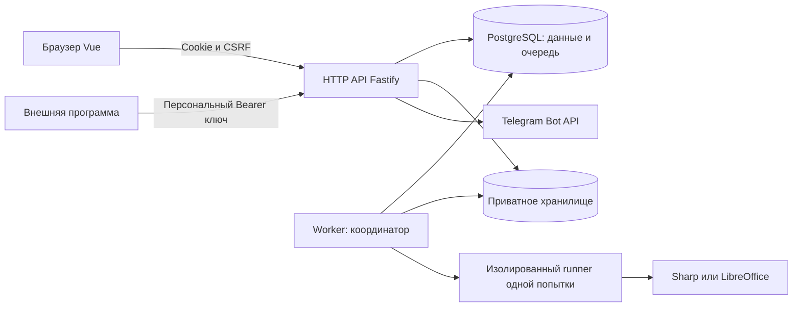

# Компоненты приложения и их взаимодействие

Версия 0.2 · 17 ноября 2026 г.

Назначение — границы компонентов, их взаимодействие, изоляция и очередь. Подробное расположение кода и подготовка к размещению на сервере описаны в [структуре проекта](09-архитектура-приложения.md). Основание: [ТЗ](01-техническое-задание.md), [API](03-api.md) и [выбор технологий](04-выбор-технологий.md). Таблицы и ограничения данных описаны отдельно в [модели данных](07-модель-данных.md).

## 1. Компоненты и взаимодействие

Организация — **модульный backend с отдельным worker**, а не набор микросервисов. Fastify занимается HTTP/проверками; сервис задач — квотами/владением/состояниями; runner — только преобразованием одного файла. Браузер не передаёт секрет Telegram или серверный ключ и не выбирает исполняемый путь движка.

### Где проходит граница изоляции

Worker имеет доступ к очереди/хранилищу и управляет попыткой. Runner получает только случайные пути конкретного input/output, направление и публичные настройки. Ему не передаются DB URL, токены, volume с библиотекой пользователей и домашний каталог хоста.

Предложение для Linux: отдельный rootless OCI-контейнер на попытку, без сети, с read-only root, ограничением ресурсов и разрешёнными mount только этой задачи. Координатор запускается отдельным системным пользователем на доверенном worker-хосте. Rootless Docker/Podman — вариант реализации, который нужно выбрать и испытать в этапе 0. API-контейнеру не выдавать Docker socket; не запускать привилегированный runner ради обхода ошибок прав. На macOS потребуется VM контейнерного runtime; это зависимость разработки, не npm-пакет.

Контейнеризация API/БД через Compose и ограничение runner — разные задачи. Один обычный worker-контейнер с сетью, секретами и всеми файлами не удовлетворяет REQ-16. Публичный запуск блокируется, пока конкретная схема изоляции не подтверждена. [Docker Rootless](https://docs.docker.com/engine/security/rootless/).

### Надёжная очередь и файлы

pg-boss поддерживает custom DB adapter и постановку задачи в существующую транзакцию. Использовать один `pg` transaction client для job/квоты/idempotency/enqueue. Конвертация происходит вне транзакции; публикация результата — короткая условная транзакция по lease. Восстановление/очистка покрывает границу между PostgreSQL и файловой системой. «Exactly once» для всей конвертации и дисковых побочных эффектов не обещается. [pg-boss adapters](https://github.com/timgit/pg-boss/blob/12.38.2/docs/api/adapters.md), [pg-boss jobs](https://github.com/timgit/pg-boss/blob/12.38.2/docs/api/jobs.md).

### Расположение реализации

Границы из этой схемы отображаются на `apps/web`, `apps/api`, `apps/worker` и общие пакеты. Карта папок, направление зависимостей, хранение данных и схема первого сервера заданы в [структуре проекта и развёртывании](09-архитектура-приложения.md).

## 2. Зависимости реализации

- [TASK-00](tasks/00-технический-эксперимент.md) подтверждает работу движков, изоляции и общей транзакции очереди. Результат фиксирует выбранный runtime и версии.
- [TASK-01](tasks/01-каркас.md) создаёт компоненты и интерфейсы storage/runner по этой схеме и миграции по модели данных.
- [TASK-03](tasks/03-конвертация.md) реализует жизненный цикл задач из API и REQ-05/16/17, не меняя границы доступа runner.
- [TASK-06](tasks/06-подготовка-выпуска.md) проверяет очистку, восстановление и ресурсы на целевом стенде.

Входные ограничения берутся из REQ-04: для DOCX учитывается размер загруженного файла. Отдельные пороги пикселей, длины стороны, объёма распакованного DOCX, числа элементов архива и коэффициента сжатия не задаются. Проверка формата и структуры сохраняется; обработка выполняется в пределах ресурсов и времени REQ-16. Не вводить скрытые ограничения этих категорий в конфигурацию движков или форму загрузки.

При изменении границ компонентов обновить [модель данных](07-модель-данных.md), [API](03-api.md) и затронутые [задачи и приёмку](05-план-и-приёмка.md).
