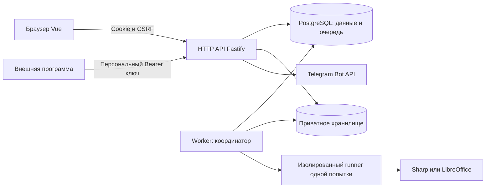
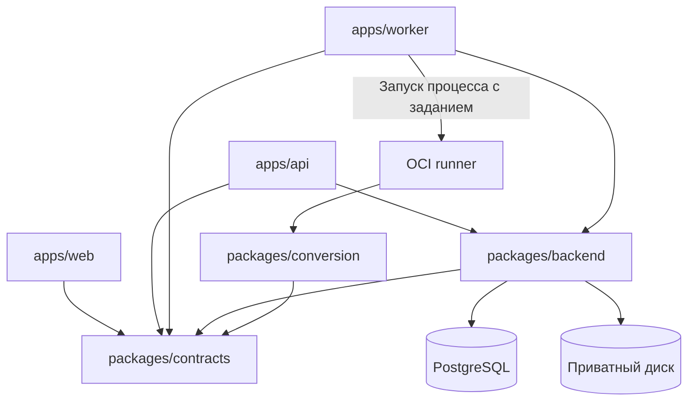
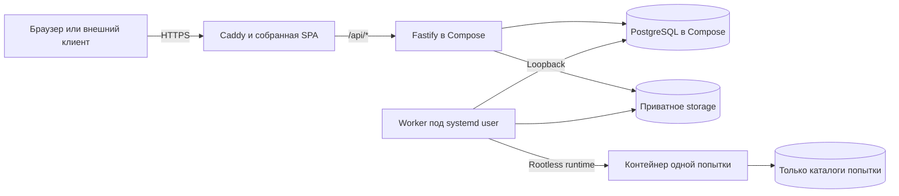

# Архитектура приложения

Версия 0.2 · 18 ноября 2026 г. · Статус — предложение для реализации.

Документ определяет компоненты и их взаимодействие, границы изоляции, работу очереди, расположение кода, направление зависимостей и способ переноса приложения на первый Linux-сервер. Карта ниже — целевая структура приложения, включая будущие исходники. В IT-0014 подготовлены пустые каталоги шести npm workspaces, manifests/lock и декларативные настройки; исходники web/API/worker, JS-конфигурации, миграции и runner ещё не создавались. Фактические файлы и доступные команды — в [подготовке окружения](project-setup.md); актуальный состав — в [статусе проекта](project-status.md).

Основание — [ТЗ](product-requirements.md), [экраны](screens-and-flows.md), [API](api.md), [выбор технологий](technology-decisions.md), [модель данных](data-model.md). Продуктовые ограничения, лимиты и правила доступа берутся из этих документов.

В текущей подготовке конфигурация локальной БД находится в корневом `compose.yaml`; файлы `infra/compose*.yaml`, `.env.example`, Dockerfile и точки входа на целевой схеме ниже ещё не созданы. Примеры и исходники исключены по запросу владельца.

## 1. Организация приложения

Рекомендую один репозиторий с npm workspaces. Это модульный backend с отдельным worker. В нём три запускаемые части — Vue-интерфейс, HTTP API и фоновый worker. Общие серверные правила находятся в одном пакете. PostgreSQL хранит данные приложения и очередь pg-boss. Приватный диск хранит загруженные файлы и результаты. Каждая попытка конвертации выполняется в отдельном ограниченном runner.

Такая организация позволяет вместе проверять и выпускать связанные изменения интерфейса, сервера и контрактов. API и worker запускаются отдельными процессами и используют общую реализацию бизнес-правил. npm поддерживает несколько локальных пакетов в одном корневом проекте и связывает их зависимости при установке. [Документация npm workspaces](https://docs.npmjs.com/cli/v11/using-npm/workspaces/).

Первое размещение рассчитано на один Linux-сервер и одного одновременно работающего runner согласно ТЗ. Все компоненты выпускаются под единым идентификатором релиза, связанным с Git-коммитом. Выбранные ранее JavaScript, Vue, Fastify, PostgreSQL и pg-boss сохраняются как основа. Точные версии закрепляются после TASK-00 в lock-файле и образах.

### Компоненты и взаимодействие




Fastify занимается HTTP/проверками; сервис задач — квотами/владением/состояниями; runner — только преобразованием одного файла. Браузер не передаёт секрет Telegram или серверный ключ и не выбирает исполняемый путь движка.

### Граница изоляции

Worker имеет доступ к очереди/хранилищу и управляет попыткой. Runner получает только случайные пути конкретного input/output, направление и публичные настройки. Ему не передаются DB URL, токены, volume с библиотекой пользователей и домашний каталог хоста.

Предложение для Linux: отдельный rootless OCI-контейнер на попытку, без сети, с read-only root, ограничением ресурсов и разрешёнными mount только этой задачи. Координатор запускается отдельным системным пользователем на доверенном worker-хосте. Rootless Docker/Podman — вариант реализации, который нужно выбрать и испытать в этапе 0. API-контейнеру не выдавать Docker socket; не запускать привилегированный runner ради обхода ошибок прав. На macOS потребуется VM контейнерного runtime; это зависимость разработки, не npm-пакет.

Контейнеризация API/БД через Compose и ограничение runner — разные задачи. Один обычный worker-контейнер с сетью, секретами и всеми файлами не удовлетворяет REQ-16. Публичный запуск блокируется, пока конкретная схема изоляции не подтверждена. [Docker Rootless](https://docs.docker.com/engine/security/rootless/).


## 2. Карта репозитория

```text
project_senior/
├── apps/
│   ├── web/                         # Vue SPA
│   │   ├── src/
│   │   │   ├── app/                 # Точка входа, маршрутизатор, оболочка
│   │   │   ├── pages/               # Страницы из документа 02
│   │   │   ├── features/
│   │   │   │   ├── auth/            # Вход, регистрация, восстановление
│   │   │   │   ├── conversion/      # Выбор файла, загрузка, статус
│   │   │   │   ├── files/           # Библиотека и скачивание
│   │   │   │   └── account/         # Профиль, настройки, ключ, Telegram
│   │   │   └── shared/              # UI, HTTP-клиент, стили, форматирование
│   │   ├── public/                  # Только публичные статические ресурсы
│   │   ├── index.html
│   │   └── package.json
│   ├── api/
│   │   ├── src/
│   │   │   ├── app.js              # Собрать Fastify без открытия порта
│   │   │   ├── server.js           # Конфигурация, listen, завершение
│   │   │   ├── plugins/            # Сессии, CSRF, схемы, requestId
│   │   │   └── routes/
│   │   │       ├── auth/           # /api/auth/*
│   │   │       ├── app/            # /api/app/*
│   │   │       ├── v1/             # /api/v1/*
│   │   │       └── integrations/   # Telegram webhook
│   │   └── package.json
│   └── worker/
│       ├── src/
│       │   ├── main.js            # Запуск, соединения, завершение
│       │   ├── jobs/              # Приём задач и выполнение попыток
│       │   ├── runner/            # Запуск и остановка OCI-контейнера
│       │   └── maintenance/       # Очистка, восстановление lease
│       └── package.json
├── packages/
│   ├── contracts/                 # Только безопасные публичные определения
│   │   ├── src/                   # JSON Schema, DTO, enum, коды ошибок
│   │   └── package.json
│   ├── backend/                   # Общая серверная реализация
│   │   ├── src/
│   │   │   ├── modules/
│   │   │   │   ├── identity/       # Учётные записи, сессии, восстановление
│   │   │   │   ├── account/        # Профиль, настройки, API-ключ, Telegram
│   │   │   │   ├── conversions/    # Задачи, квоты, отмена, публикация
│   │   │   │   └── files/          # Метаданные, доступ, удаление
│   │   │   ├── db/                # pg pool и граница транзакции
│   │   │   ├── queue/             # pg-boss и enqueue с transaction client
│   │   │   ├── storage/           # Приватный файловый адаптер
│   │   │   ├── integrations/      # Адаптер Telegram
│   │   │   └── config/            # Проверка серверной конфигурации
│   │   └── package.json
│   └── conversion/                # Код внутри изолированного runner
│       ├── src/
│       │   ├── main.js            # Одна попытка, результат, код завершения
│       │   ├── engines/           # Sharp и LibreOffice
│       │   └── validation/        # Проверка входа и результата
│       └── package.json
├── db/
│   └── migrations/                # Нумерованные SQL-миграции приложения
├── infra/
│   ├── compose.yaml               # Первый сервер, параметры из окружения
│   ├── compose.dev.yaml           # Локальная БД и зависимости разработки
│   ├── api/Dockerfile
│   ├── web/Dockerfile              # Сборка SPA и публичный HTTP-сервер
│   ├── web/Caddyfile               # HTTPS, SPA и reverse proxy к API
│   ├── runner/                    # Образ движков, шрифты, профиль запуска
│   └── systemd/                   # Пользовательский сервис worker
├── scripts/                       # verify_docs.py уже есть; прикладные проверки/миграции/выпуск — план
├── tests/
│   ├── integration/               # БД, очередь, API-worker-storage
│   ├── e2e/                       # Сценарии пользователя
│   └── fixtures/                  # Только искусственные файлы
├── api/openapi.json               # Существующий внешний контракт
├── docs/                          # Существующие спецификации и история
├── заметки/                       # Учебные материалы по правилам .gitignore
├── .local/                        # Локальные данные и отчёты вне Git
├── .env.example                   # Имена настроек и безопасные примеры
├── .gitignore
├── .dockerignore
├── AGENTS.md
├── README.md
├── package.json                   # private, workspaces, общие команды
└── package-lock.json              # Один lock-файл на весь репозиторий
```

Внутри feature создаются нужные компоненты, composables и функции API по мере реализации. Небольшому разделу достаточно нескольких файлов. `shared` принимает только действительно используемые несколькими разделами элементы.

Внутри серверного модуля достаточно `service.js`, `repository.js` и теста рядом с логикой. SQL и выборки с проверенным владельцем находятся в repository, сценарий и транзакционная граница — в service. HTTP-схемы и сериализация относятся к API и contracts. Новые уровни и пакеты добавляются при появлении конкретной ответственности.

## 3. Направление зависимостей



| Часть     | Ответственность                                                                 | Разрешённые связи                                                               |
| -------------- | ---------------------------------------------------------------------------------------------- | ----------------------------------------------------------------------------------------------- |
| `web`        | Экран, форма, клиентское состояние, ожидание задачи | HTTP API и публичные contracts                                                        |
| `api`        | HTTP, авторизация, схемы, поток загрузки/скачивания     | Сервисы backend и contracts                                                             |
| `worker`     | Очередь, lease, запуск попытки, обслуживание                   | Сервисы backend, адаптер runner                                                   |
| `backend`    | Бизнес-сценарии, SQL, storage, очередь                                    | contracts, PostgreSQL, диск и нужные интеграции                            |
| `conversion` | Преобразование и проверка одного файла                       | Выданные каталоги, движки и публичные определения    |
| `contracts`  | Формы данных и публичные константы                               | Самодостаточные определения для браузера и сервера |

Приложения используют именованные exports пакетов. Между приложениями обмен идёт через API и очередь. Fastify request/reply остаются в HTTP-слое, сервисам передаются проверенный actor, входные данные и необходимые зависимости. Объект actor отражает проверенную сессию или API-ключ.

Два HTTP-контура `/api/app` и `/api/v1` вызывают один сервис `conversions`. Он обеспечивает общие квоты, права, идемпотентность и состояния. Способ авторизации и форма ответа выбираются маршрутом. Значения лимитов задаются серверной конфигурацией и выдаются интерфейсу через существующий endpoint форматов.

`packages/backend` содержит единственное определение правил и используется API и worker. Операции сессии и Telegram подключаются в API, обработчик очереди и runner — в worker. Зависимости создаются явно при старте соответствующего приложения. Импорт модуля сам по себе только объявляет функции.

Разделение фабрики `app.js` и запуска `server.js` позволяет проверять HTTP через Fastify inject. [Руководство Fastify по тестированию](https://github.com/fastify/fastify/blob/main/docs/Guides/Testing.md).

## 4. Контракты, БД и файлы

`api/openapi.json` остаётся исходником внешнего контракта. `packages/contracts` содержит исполняемые схемы публичных DTO и определения внутренних browser API. При реализации внешние схемы извлекаются из OpenAPI в воспроизводимом шаге либо проверяются на соответствие ему. Выбранный способ фиксируется в TASK-01 и команде `check`. Персональные данные, хеши, секреты и DB-модель доступны только серверному пакету. `.env.example` перечисляет настройки без реальных секретов. Сборка frontend получает только явно разрешённые публичные значения, DB URL и Telegram/session secrets остаются в серверном окружении.

Прикладные миграции находятся в `db/migrations/`, проходят по порядку и записываются в таблицу версии. Обновления схемы pg-boss выполняются отдельным управляемым шагом с закреплённой версией библиотеки. За запуск миграций отвечает один процесс выпуска. API и worker при старте проверяют совместимость схемы и подключаются после завершения миграций.

pg-boss поддерживает custom DB adapter и постановку задачи в существующую транзакцию. [pg-boss adapters](https://github.com/timgit/pg-boss/blob/12.38.2/docs/api/adapters.md), [pg-boss jobs](https://github.com/timgit/pg-boss/blob/12.38.2/docs/api/jobs.md).

Backend использует один `pg` transaction client для создания job, резерва квоты, идемпотентности и постановки в очередь. Модули получают этот client явно. Преобразование выполняется между короткими транзакциями. Подробные инварианты заданы в [модели данных](data-model.md).

Хранилище получает непрозрачный storage key. В БД хранятся key, владелец, размер, хеш и срок. Абсолютные пути определяются конфигурацией среды. Пользовательское имя применяется к безопасному имени скачивания. Небольшой адаптер storage обеспечивает операции записи потока, чтения, проверки наличия и удаления, а также выдачу локального пути для подготовки попытки worker.

Для первого сервера предлагается следующая раскладка данных.

```text
/srv/converter/
├── releases/<release-id>/          # Версионированный runtime-пакет worker
├── current -> releases/<release-id>
├── data/
│   ├── postgres/                  # Постоянный каталог PostgreSQL
│   ├── storage/
│   │   ├── uploads/               # Долговечно принятые исходники
│   │   ├── results/               # Проверенные временные/сохранённые результаты
│   │   └── staging/               # Незавершённые загрузки
│   ├── attempts/<attempt-id>/     # Только input/output конкретной попытки
│   └── caddy/                     # Состояние HTTPS и сертификаты
└── config/                        # Секреты и параметры с ограниченными правами
```

Каталоги данных и конфигурации переживают замену релиза. Backup хранится дополнительно на отдельном носителе или удалённом хранилище. Локальная копия на том же сервере может использоваться для подготовки переноса.

Принятый исходник сохраняется долговечно до DB commit. Worker подготавливает отдельную рабочую папку попытки и передаёт runner только input read-only, output и ограниченное временное пространство. Скопированный input или отдельный bind mount выбираются по проверенному профилю изоляции. Результат проверяется, сохраняется в storage и затем публикуется условной транзакцией по lease. Сбой между диском и БД обрабатывается восстановлением и сборщиком согласно REQ-17. «Exactly once» для всей конвертации и дисковых побочных эффектов не обещается.

Входные ограничения берутся из REQ-04: для DOCX учитывается размер загруженного файла. Отдельные пороги пикселей, длины стороны, объёма распакованного DOCX, числа элементов архива и коэффициента сжатия не задаются. Проверка формата и структуры сохраняется; обработка выполняется в пределах ресурсов и времени REQ-16. Не вводить скрытые ограничения этих категорий в конфигурацию движков или форму загрузки.

## 5. Как проходит запрос

1. Браузер открывает SPA на едином HTTPS origin. Запросы `/api/*` попадают в Fastify. Для разработки Vite проксирует эти пути к локальному API, что сохраняет поведение cookie и CSRF.
2. API проверяет сессию либо персональный ключ, принимает файл потоком и вызывает общий сервис задач. После долговечной записи исходника и атомарного commit возвращается `202`.
3. Worker получает идентификатор задачи из pg-boss, подтверждает право на попытку, подготавливает её каталоги и запускает runner.
4. Runner конвертирует один файл и завершает работу. Worker проверяет результат и актуальность lease, публикует состояние и освобождает резерв.
5. Интерфейс опрашивает существующий endpoint состояния, показывает результат и получает файл через API с повторной проверкой владельца и срока.
6. Отмена, повтор после допустимого инфраструктурного сбоя и очистка используют те же серверные правила. Повторная доставка задания безопасна благодаря идемпотентной публикации.

PostgreSQL обслуживает данные и очередь. Периодические задачи очистки и восстановления выполняются worker с блокировкой/lease, чтобы второй экземпляр после рестарта продолжал согласованную работу. Интерфейс восстанавливает активные задачи через API при повторном открытии страницы.

## 6. Первый сервер

Предлагаемый вариант — Docker Compose для web/reverse proxy, API и PostgreSQL, пользовательский systemd-сервис для worker и rootless OCI runtime для запуска runner. Caddy выбран как простой вариант единого входа с HTTPS. Конкретные настройки домена и выпуска сертификата задаются при размещении. Для автоматического HTTPS потребуются DNS-записи на сервер, доступные порты и постоянный каталог состояния Caddy. Runtime и права каталогов подтверждаются в TASK-00. [Автоматический HTTPS Caddy](https://caddyserver.com/docs/automatic-https).



| Компонент | Где работает                                    | Что получает                                                                                                         |
| ------------------ | ---------------------------------------------------------- | ------------------------------------------------------------------------------------------------------------------------------- |
| Web/Caddy          | Compose                                                    | Собранную SPA, публичные настройки, состояние сертификатов, доступ к API |
| API                | Compose                                                    | DB URL, session/Telegram secrets, storage, доступ к Telegram                                                             |
| PostgreSQL         | Compose                                                    | Постоянный каталог БД, отдельные прикладную и очередь схемы                  |
| Worker             | Хост, systemd user                                     | Собственный DB URL, storage, разрешение запускать runner                                          |
| Runner             | Краткоживущий rootless OCI-контейнер | Один input, output, движки, шрифты, ограничения REQ-16                                               |

Внутри Compose API обращается к `db:5432`. Для worker БД публикуется только на loopback хоста, например `127.0.0.1:15432`. Пользовательский runtime принадлежит выделенной учётной записи сервиса. API получает доступ к данным через согласованные bind mounts, worker — через локальные пути. Compose использует rootless runtime этой учётной записи. Доступность публичных портов 80/443 для rootless-процесса обеспечивается поддерживаемой настройкой хоста и проверяется при подготовке сервера.

На TASK-00 проверить реальное соответствие UID/GID, доступ API к storage и права runner на конкретный output. Профиль runner должен обеспечивать REQ-16, включая сеть, дерево процессов, память и временный диск. Rootless runtime работает от непривилегированного пользователя. Для применения лимитов проверяются поддержка cgroups и конфигурация целевого Linux. [Документация Docker Rootless](https://docs.docker.com/engine/security/rootless/).

Worker запускается на хосте, чтобы обращаться к rootless runtime напрямую и передавать ему разрешённые пути попытки. HTTP-процесс получает только необходимые подключения и mount. Управление runtime доступно worker. У reverse proxy отсутствуют mount приватных файлов. Скачивание проходит через API. Внешний вход открыт через HTTPS, служебные подключения ограничены локальной сетью и loopback. Правило SPA fallback применяется к страницам интерфейса, ответы `/api/*` сохраняют HTTP-статус и JSON. [Пример разделения SPA и API в Caddy](https://caddyserver.com/docs/caddyfile/patterns#single-page-apps-spas).

В Compose описываются healthcheck и ожидание готовности БД. После старта приложения должны обрабатывать потерю подключения, а worker — корректно восстанавливаться. Compose поддерживает ожидание `service_healthy` для зависимостей. [Порядок запуска Compose](https://docs.docker.com/compose/how-tos/startup-order/).

## 7. Сборка и перенос релиза

Контекст Docker-сборки — корень репозитория, поскольку приложения импортируют общие workspaces и используют корневой lock-файл. `.dockerignore` исключает секреты, `.local`, приватные файлы и локальные зависимости. Multi-stage сборка web отдаёт только статический результат. Runtime API и worker получают необходимые серверные пакеты и production-зависимости с сохранением структуры workspaces.

Поставка одного релиза включает web/API образы, образ runner, runtime-пакет worker, миграции и манифест версий. Node runtime worker должен совпадать с закреплённой совместимой версией серверных пакетов. Нативные зависимости собираются под Linux и архитектуру сервера. Локальные `node_modules` с macOS в поставку не входят. Манифест фиксирует Git-коммит и точные идентификаторы образов.

Первый перенос можно выполнить архивами образов и runtime-пакета через SSH. После появления потребности образам можно назначить приватный registry. В обоих случаях сервер получает тот же проверенный набор артефактов.

Порядок обновления первого сервера допускает короткое окно обслуживания.

1. Собрать и проверить релиз, поместить runtime-пакет в новый каталог `releases`, загрузить образы. Проверить конфигурацию и свободное место до переключения.
2. Включить режим обслуживания на входе API, дождаться завершения текущих запросов и попыток, остановить API и worker. Сохранить согласованный backup БД, постоянных файлов и журнала удалений по REQ-18.
3. Одним процессом применить миграции приложения и pg-boss. При ошибке сохранить режим обслуживания и выяснить состояние миграции.
4. Запустить новую версию API, переключить `current` worker на тот же релиз, запустить worker и web. Проверить готовность, доступ к БД/storage, приём и выполнение искусственной задачи, вход и приватное скачивание.
5. После smoke-проверки открыть пользовательский трафик. Сохранить предыдущий комплект артефактов и результат выпуска.

Предпочитать добавочные совместимые миграции, пока предыдущая версия остаётся кандидатом на откат. Откат приложения допустим при совместимости со схемой БД. Восстановление БД/файлов требует отдельной процедуры с учётом новых данных и журнала удалений. Пробное восстановление на отдельном стенде входит в TASK-06.

## 8. Локальная работа и автоматические проверки

На Linux в разработке web, API и worker запускаются локальными Node-процессами, PostgreSQL — через dev Compose, runner — через выбранный rootless runtime. На macOS для интеграционных проверок API, worker, БД и storage размещаются вместе в Linux VM с тем же runtime. Vite может работать на macOS и проксировать API в VM через настроенный локальный порт. Так пути файлов worker совпадают с путями, доступными runner. Параметры различаются по окружениям, структура импортов и бизнес-правила общие.

При создании каркаса предлагается закрепить следующие команды. Сейчас это проект интерфейса команд, их реализация относится к TASK-01 и последующим задачам.

| Команда            | Назначение                                                                                                         |
| ------------------------- | ---------------------------------------------------------------------------------------------------------------------------- |
| `npm ci`                | Воспроизводимая установка всех workspaces по lock-файлу                                   |
| `npm run dev`           | Согласованный запуск локальных web/API/worker                                                    |
| `npm run db:migrate`    | Управляемое применение миграций к явно выбранной БД                             |
| `npm run check`         | Сейчас — документация, дерево зависимостей и формат настроек; при реализации добавить схемы и соответствие серверу |
| `npm test`              | Нужные модульные и интеграционные проверки с отдельной тестовой БД |
| `npm run test:e2e`      | Сквозные пользовательские сценарии на тестовой среде                          |
| `npm run build`         | Production-сборка web и проверка комплектности серверных пакетов                 |
| `npm run release:build` | Подготовка связанного комплекта серверных артефактов                         |

Модульные тесты размещаются рядом с проверяемой логикой. Интеграционные и e2e используют `tests/`, отдельные БД и storage с искусственными файлами. Для конвертации нужны fixtures и проверки сбоев, lease, отмены и изоляции. Эти тесты добавляются вместе с реализацией соответствующих сценариев.

Навык `git-commit` автоматически выбирает и запускает необходимые проверки перед готовым коммитом и ревью. Текущий порядок записан в [Git-процессе](git-flow.md). После появления команд их фактические названия добавляются туда и в README. При подключении CI он запускает тот же набор команд для проверяемого релиза.

## 9. Как наращивать нагрузку

| Наблюдаемая потребность                           | Следующий шаг                                                                                                                                                                                                                  |
| ----------------------------------------------------------------------- | ------------------------------------------------------------------------------------------------------------------------------------------------------------------------------------------------------------------------------------------ |
| Конвертация заполняет ресурсы сервера | Измерить потребление и увеличить параллельность worker в пределах бюджета и лимитов                                                                                     |
| Требуется второй worker-хост                         | Перевести storage на S3-совместимый адаптер, скачивать input в локальный каталог попытки, загружать проверенный output перед публикацией |
| API требуется несколько экземпляров        | Общие сессии, квоты и ограничения частоты остаются в PostgreSQL, storage становится общим, перед API работает балансировщик                           |
| БД становится узким местом                       | Проверить запросы, индексы, пулы и нагрузку очереди, затем выделить PostgreSQL на отдельный сервер                                                                |
| Релизов становится больше                        | Автоматизировать существующий выпуск и проверки через CI и registry                                                                                                                       |

Файловый адаптер для второго хоста потребует явного этапа materialize/upload вместо локального пути. Благодаря storage key в БД и отдельному контракту runner эта доработка локализуется в storage и подготовке попытки worker.

## 10. Порядок реализации

- [TASK-00](tasks/00-technical-spike.md) подтверждает движки, изоляцию, права каталогов, Linux runtime и общую транзакцию очереди. Результат фиксирует выбранный runtime и версии.
- [TASK-01](tasks/01-project-scaffold.md) создаёт workspaces, серверные границы, contracts, интерфейсы storage/runner, миграции по модели данных, dev-окружение и первые реальные команды проверки.
- TASK-02–05 заполняют модули по существующим задачам, сохраняя общие серверные правила для сайта и внешнего API. [TASK-03](tasks/03-conversion.md) реализует жизненный цикл задач из API и REQ-05/16/17, сохраняя границы доступа runner.
- [TASK-06](tasks/06-release-preparation.md) оформляет реальный release-пакет, эксплуатационные инструкции, backup/restore и проверяет очистку, восстановление и ресурсы на целевом Linux-стенде.

Рабочий каркас создаётся после результатов TASK-00. Предложенные здесь Caddy, пользовательский systemd-сервис worker, пути `/srv/converter` и способ упаковки релиза уточняются по возможностям выбранного сервера и эксперименту. Проверки и результаты реализации фиксируются в истории проекта.

При изменении границ компонентов обновить [модель данных](data-model.md), [API](api.md) и затронутые [задачи и приёмку](implementation-and-acceptance.md).
